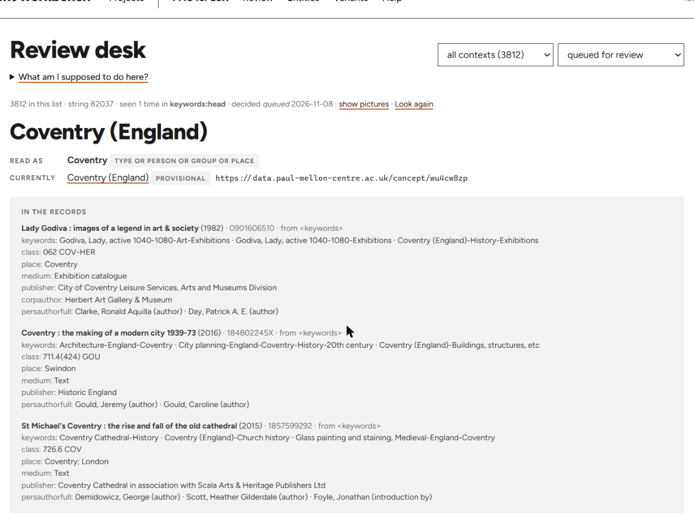
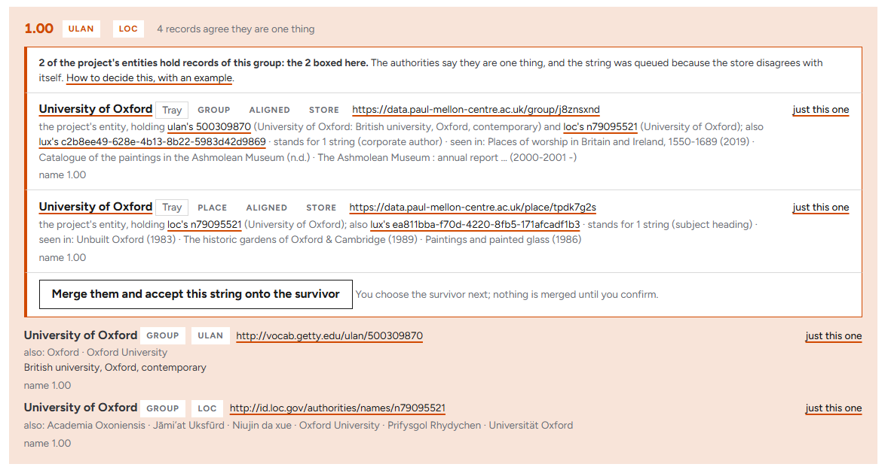
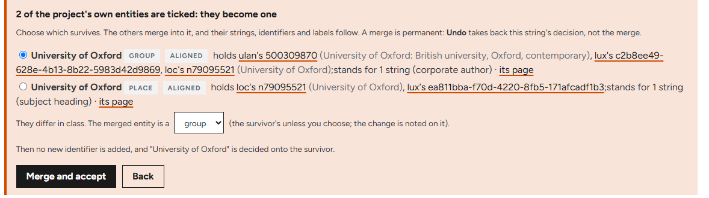
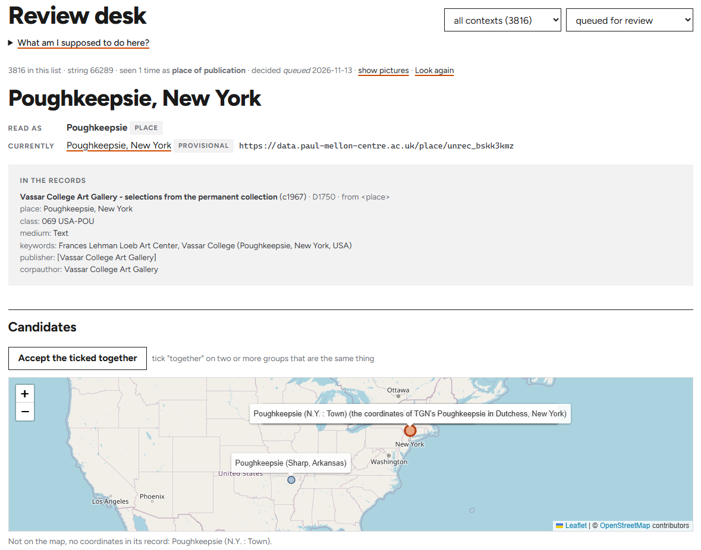
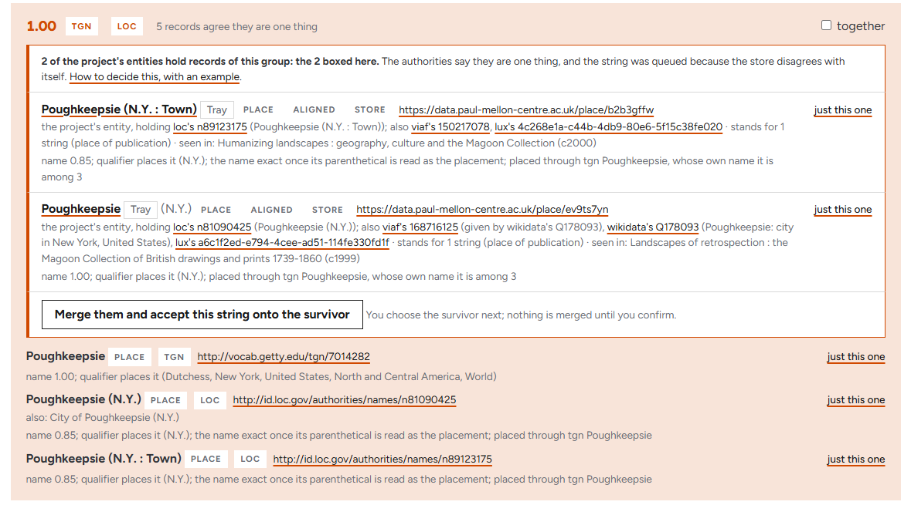
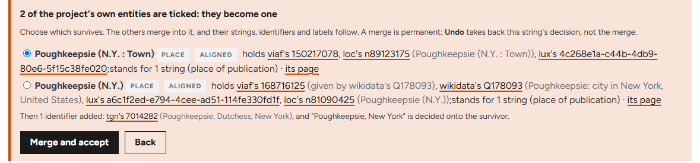
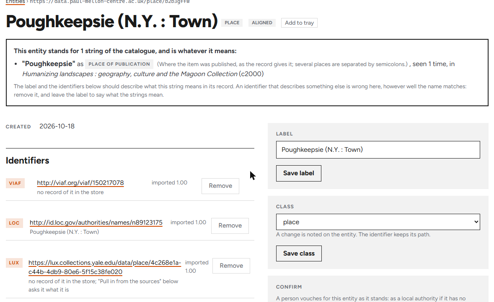

# Workbench scenarios

Common situations at the review desk, each with a real example and what a reviewer does about it. This is the
worked-example companion to the user guide ([13-workbench-guide.md](13-workbench-guide.md)), which describes every
part of the desk; here each entry starts from what you see on the screen.

Every entry has the same shape:

- **Scenario**: the situation in a sentence, and how to recognise it.
- **Example**: a real string, the state of the workbench when the pictures were taken, and a link to it.
- **Solution**: what the reviewer does for that example, step by step, and what to check before pressing anything.
- **Watch for**: when the usual solution is wrong.

The examples are from the PMC project. Pictures are in `img/scenarios/`, named by scenario and step. A picture
shows the store as it was on the date given; once the example is decided it leaves the queue, so the link then shows
the decided string rather than the picture's state.

Scenarios so far: [Holder pair](#holder-pair); [The authorities hold two, the project means one](#the-authorities-hold-two-the-project-means-one). The list to come is at the [end](#scenarios-to-write).

**Keeping the pictures true.** A picture shows the workbench as it was built on the day it was taken. Each scenario
says when its pictures were taken; when the desk or the entity page changes, the scenarios that show the changed
part are retaken, and the table at the end records which were last checked against which change.

---

## Holder pair

**Scenario.** The project has the same thing twice. Two of the project's own entities each hold an identifier from
an outside authority, and the authorities say those identifiers are one thing. The software cannot choose between
the two entities without guessing and never merges entities on its own, so the string waits for a person. You
recognise it by the line at the head of the first candidate group: "2 of the project's entities hold records of this
group".

**Example.** "University of Oxford", the main heading of a subject (`keywords:head`), string 80550, as queued by run
rhf5rg; pictures taken 2026-11-14. http://localhost:5200/p/pmc/review?id=80550

The string and the catalogue records it was seen in:

The first candidate group. Four records "agree they are one thing", and two of them are the project's own, boxed
together under the sentence that says so. Both are called "University of Oxford". One is a group, standing for a
corporate author; the other is a place, standing for a subject heading. Each row lists what the entity holds, every
identifier a link that says what its record is: both hold the Library of Congress's `n79095521`.

**Solution.**

1. *Decide whether the two entities are the same thing.* Read the two boxed rows: class, what each holds, which
   strings each stands for and in which fields, and the records each was seen in. Here both hold the same Library of
   Congress record, which is the university as a body, and the books behind both are about the university and its
   buildings. They are one thing, entered twice by an earlier import, once as a body and once as a place. If you need
   more, each entity's name opens its page in another tab; the page begins with what the entity stands for.
2. *Press "Merge them and accept this string onto the survivor"*, at the foot of the box. Nothing is merged yet. A
   confirm step opens:

   

3. *Choose the survivor.* The other entity merges into it, and its strings, identifiers and labels follow, so
   nothing is lost either way; what you are choosing is the URI and label that remain. Prefer the one that holds
   more and is of the right class. Here that is the group: it holds ULAN's record as well.
4. *When the two differ in class, choose the class.* The step says "They differ in class" and offers the choice; the
   survivor's is the default. A university is a group.
5. *Read the line "Then ... identifiers added" before confirming.* These are the group's records that neither entity
   holds yet, each a link saying what it is, and they will be attached to the survivor. Each should be the same thing
   as the survivor. Here none is added: between them the two entities already hold the group's records.
6. *Press "Merge and accept"*, or "Back" to leave everything as it was. A merge is permanent: "Undo last decision"
   takes back the string's decision, not the merge. Afterwards the string, and the other queued strings of the same
   name, leave the queue.

**Watch for.**

- *Two things, not one.* The authorities sometimes lump together things the project keeps apart: the Grosvenor
  Gallery of 1877 to 1890 and the later dealer of the same name. If the two rows differ in dates, place or what they
  were seen in, do not merge; accept the string onto the right one with **just this one**. If the card shows nothing
  that tells the pair apart, that is a fault in the desk: report it.
- *Records in the group that are not the thing.* The count "4 records agree" is the software's claim, not a fact; the
  confirm step's list of identifiers is where you check it. "Coventry (England)", the first example written here,
  had two dioceses in its group ("Church of England. Diocese of Coventry"), and the merge would have given the city
  their identifiers. That fault is mended (a body placed in a city no longer joins the city's group), but the habit
  stands. When a group does hold a record that is not the thing, leave the box's button alone: put both entities in
  the tray (**Tray** on each row), merge them on the tray's page, then back at the desk press **Look again** and
  **just this one** on the survivor's row. That is how Coventry was decided.
- *The same name, different identifiers.* Two entities of one name with different Wikidata or VIAF numbers may be
  duplicates the authorities also hold twice, or two different things. "Dagenham" and "Dagenham (London, England)"
  were the second kind: one held Wikidata's record for the town, the other its record for the former parliamentary
  constituency, an old mistaken alignment. The project means the town by both, so merging is right, but the
  constituency's identifiers come along and must then be removed on the survivor's page. Better, open the mistaken
  entity's page first ("its page"): its identifiers are boxed in sets under what they are, and "Remove all" takes
  the constituency's set off in one press; then merge. Do not relabel the entity to match its wrong identifiers
  ("Dagenham (parliamentary constituency)"): an entity is what its strings mean, and this one stands for a place of
  publication, the town.
- *Different classes.* The confirm step says so when the two entities differ in class. A group and a place of one
  name, holding the same record, are usually one institution entered twice, as here. A person and a group are more
  often two things (a dealer and his firm): look before merging.

---

## The authorities hold two, the project means one

**Scenario.** Two of the project's entities have the same name and stand for the same kind of string, but each is
aligned to a different record of the *same* authority. An authority that keeps two records of one name is saying
they are two things: a city and the township around it, a town and its district, a place and the constituency named
after it. The project usually means only one of them. You recognise it by two identifiers of one source on the
card that differ ("loc's n81090425" and "loc's n89123175"), and by a type word in one heading: "(N.Y. : Town)",
"(England : District)", "(France : Canton)".

**Example.** "Poughkeepsie, New York", a place of publication, string 66289, as queued by run rhf5rg; pictures
taken 2026-11-14. http://localhost:5200/p/pmc/review?id=66289

The string, in the record of a Vassar College Art Gallery catalogue:

The first group, as the desk offered it then: a holder pair. One entity is "Poughkeepsie (N.Y. : Town)", holding the
Library of Congress's record of that heading; the other is "Poughkeepsie (N.Y.)", holding the Library's record of
the city, and Wikidata's, described as "city in New York, United States". Both stand for a place of publication,
on two catalogues of the same collection.

The confirm step, had the merge been pressed: the survivor would hold both Library of Congress records, the city's
and the town's.

**Solution.**

1. *Do not merge straight away.* Merging two entities gives the survivor every identifier of both. Here that would
   say one place is both the city and the town.
2. *Decide what the project means.* Both strings are where a catalogue was published. That is one place, and for a
   publisher's "Poughkeepsie, N.Y." the city is the ordinary reading. The town's record is the one that does not
   belong. (If you know the publisher sat in the township, it is the other way round: the judgement is yours.)
3. *Open the entity that holds the record that does not belong* ("its page", or the entity's name). The page begins
   with what the entity stands for, then its identifiers:

   

4. *Remove the identifiers that describe the other thing.* Here all three: the Library of Congress record of the
   town, and the VIAF and LUX identifiers that came with it. When identifiers cite one another the page boxes them
   as a set with "Remove all". Leave the label alone for now; the merge takes care of it.
5. *Back at the desk, press "Look again"*, then merge the two entities with the city's as survivor, or put both in
   the tray and merge there. The entity that held the town's record now brings only its string.
6. *Check the survivor's page* afterwards: one set of identifiers, all describing the city.

**Since these pictures.** The software now reads this case itself: when one authority has two records in a group
and neither names the other, it keeps the one without a type word and sets the other aside, greyed, with the reason
"loc holds this apart from its Poughkeepsie (N.Y.)". An entity that holds only the set-aside record no longer joins
the group, so the desk no longer offers such a pair as duplicates. The cleaning above is still the way to mend an
entity that was aligned to the wrong one of the two.

**Watch for.**

- *The project may mean both.* A heading about the district's council and a place of publication in the town are
  two things, and two entities are right. Look at what each stands for before removing anything.
- *Do not relabel an entity to match the identifier it should not have.* The entity is what its strings mean.
- *A VIAF number tells you little on viaf.org.* The entity page says which record gives it; an identifier with "no
  record of it in the store" can be asked with "Pull in from the sources".

---

## Scenarios to write

The list, begun 2026-11-13 with the owner. A scenario is written when a good example is met at the desk, with its
pictures taken then; the example column names one where one is known.

**Deciding a string at the desk**

| Scenario | What the reviewer sees | Example |
|---|---|---|
| One record is plainly right | one candidate, or one far ahead, and the records agree with it: Accept | |
| Several records agree | a group of records from different files that are one thing: Accept these as one | |
| It is an entity the project already has | a group one project entity holds: Same as | |
| Two groups are the same thing | the same house as a body in one file and a person in another: tick together | an auction house in ULAN and the Library of Congress |
| A place among namesakes | several places of one name, the map, hollow markers | "Cambridge", "San Francisco, CA" |
| The right record is not offered | Something else: the search of the project's entities and the indexes | |
| The right record is greyed out | a candidate ruled out for a reason you know better than: accept anyway | a birth year two out |
| Nothing fits and the thing is real | Keep as local authority, the label, the note, "known elsewhere" | a publisher with no record anywhere |
| A spelling that recurs | Always, and what it does to later strings | |
| A person or a firm | a name in a body's field that is a person, or a firm named for one; the class question | "Ackermann and Son", "Mr Hone" (decision 16) |
| A compound subject heading | the heading decided as its parts; a part that is not a compound | "Violence--Press coverage" |
| Two placeholders of one name | the same name waiting in two fields, the same records behind both | "Lawrence" |
| The cataloguer's slip | a truncated or misspelt string: what to decide, and what to report | "Art, Baroque--Italy--ome", "Gainsville, Ga." |
| I cannot decide | Skip for now, Add note for another reviewer | |
| The card is out of date | "now held by", "the same entity as a row above", Look again | |
| Reviewing what was minted | the strings for which nothing was found | |

**Cleaning an entity**

| Scenario | What the reviewer sees | Example |
|---|---|---|
| An entity aligned to the wrong thing | the page's "stands for" panel against an identifier set that describes something else: Remove all | the bare "Dagenham" and the parliamentary constituency |
| An entity holding two things' identifiers | two boxed sets, or identifiers of another class | "Northampton" with a diocese and an archdeaconry |
| An identifier another entity holds | the refusal, the holder named, the merge offered | |
| Two entities found to be one while browsing | the tray and its merge page | |
| An identifier that no longer resolves | "LUX answered 404 Not Found" | the re-minted LUX concepts |
| What a source says | Pull in from the sources, the pictures, the map, LUX's echo of the project's own export | Cozens, Peabody |

**Putting something right**

| Scenario | What the reviewer sees | Example |
|---|---|---|
| I decided a string wrongly | Undo last decision; the decided list; reopening strings from the entity page | |
| I merged what should not have been merged | a merge is permanent: what can and cannot be taken back, and how to separate by hand | |
| Who changed this, and when | History and notes on the entity, Recent changes on the project | |

## Pictures last checked

| Scenario | Pictures taken | Shows | Stale since |
|---|---|---|---|
| The authorities hold two, the project means one | 2026-11-14, "Poughkeepsie, New York", before finding 121 | the desk's head, the first group as a holder pair, the confirm step, the Town entity's page | the group and confirm pictures show the pair as it was offered before the rule; kept as the scenario's "before" |
| Holder pair | 2026-11-14, "University of Oxford" (Coventry, the first example, being decided) | the desk's head, the first group with the pair's box, the confirm step with the class choice | current |
