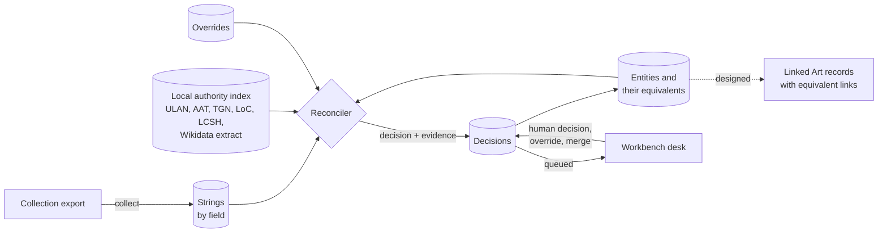
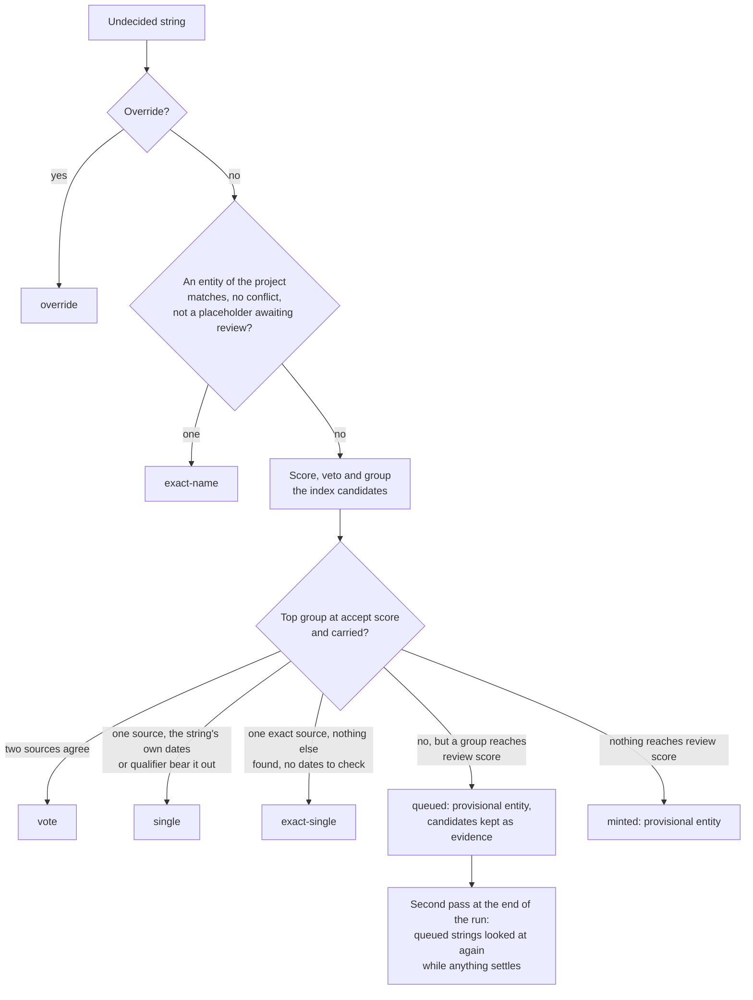

# The alignment toolkit

`LinkedArtNet.Alignment` takes the strings a collection uses to name people, organisations, places and subjects
("Thos. Agnew & Sons Ltd", "Dürer, Albrecht, 1471-1528", "Hammersmith, London", "Painting--Canada"), decides what
each one refers to, gives that thing an identifier of the collection's own, and records which entries in the
authority files (ULAN, AAT, TGN, the Library of Congress names and subjects, Wikidata) are the same thing. The
output is a set of entities with stable URIs and Linked Art `equivalent` links, ready to be written into the
collection's Linked Art records and loaded by a consumer such as LUX.

This page is the overview. The design and its record of every rule are in
[docs/10-alignment-toolkit.md](../../docs/10-alignment-toolkit.md) (long, by design); the store and loaders in
[docs/11-alignment-store.md](../../docs/11-alignment-store.md); the review workbench in
[docs/12-workbench.md](../../docs/12-workbench.md) and its user guide
[docs/13-workbench-guide.md](../../docs/13-workbench-guide.md).

## The approach in five sentences

1. **Reconcile the string, not the record.** Collections repeat names heavily; one decision about "Agnew's" serves
   every record that cites it. A string is identified by its dataset, the field it came from and its normalised
   text, because the same name as an author and as a subject may be two things.
2. **Everything repeatable is kept.** Minted identifiers, every string seen, every decision with its evidence, every
   authority record consulted, every run. A fresh dump of the collection reconciles only what is new; a published
   URI is never minted twice.
3. **Authorities are local.** Full dumps of the authority files are loaded into one PostgreSQL index and queried by
   name keys. Nothing calls a web service inside a run.
4. **Agreement is evidence; one source is a guess.** Candidates from different files that link to each other vote as
   one group. A string is accepted when the group carries it, queued for a person when it does not, and given a
   provisional entity when nothing was found, so publishing is never blocked and every gap is visible.
5. **A person's decision outranks everything, and is never overwritten.** The workbench desk shows the reviewer what
   the software saw and writes their answer back as a decision, an override or a merge that every later run honours.

## What is here

| Part | What it does |
|---|---|
| `src/LinkedArtNet.Alignment` | The library: the store (`Store/`), the loaders for Getty, Library of Congress and Wikidata dumps (`Authorities/`), the importers for an earlier system's tables and curated override files (`Import/`), and the reconciler with its reading rules, name matching, duplicate pass and the Wikidata enrichment pass (`Reconciliation/`). |
| `src/LinkedArtNet.Agents` | The agent-string parser: "Name, dates (role)" and its relatives become a name, a lifespan, roles and a nationality, by profile, with a corpus of real strings as its tests. |
| `tools/Align` | The command line: create the schema, load an index, import, reconcile, undo a run, shadow-run old decisions, audit, collect example records, merge duplicates. |
| `src/LinkedArtNet.Workbench` | The review desk and the project pages: sign-in, projects and members, the queue, entities, variants, the manifest, override export. |

Three kinds of collection knowledge live outside the code: the **manifest** (per project: which fields may name
which classes, which parser profile reads them, how compound and list strings split, thresholds, the catalogue's
home place and trades, the sources in use), the **overrides** (curated "this spelling always means this"), and the
**name-forms table** (abbreviations and noise words, `Tables/name-forms.json`). Nothing collection-specific is in
the library.

## How it works

### The store

Five kinds of row, in PostgreSQL (`Store/Schema.sql`): **entities** (our URI, class, labels, lifespan, status:
provisional, aligned, confirmed or merged) with their **equivalents** (an authority URI, the source, how and when it
was decided, by which run); **source strings** (dataset, field, raw and normalised text, the parse, occurrences;
compound and list strings also hold their parts as strings of their own); **decisions** (string, entity or none,
method, evidence as JSON, reviewer, run, valid); **overrides**; **authority records** (the cached and indexed
external records, with labels, type, lifespan and `sameAs` links); and **runs**. A string has one valid decision at
a time. A new decision invalidates the old one rather than deleting it, so undo is cheap and the history is whole.

### Reading a string

A context rule in the manifest says what a field may name (a `persauthorfull` string is a person or a group; a
`place` string a place) and which agent-string profile reads it, so "Dürer, Albrecht, 1471-1528" becomes a name, a
lifespan and whatever role or nationality the string carried. The name then yields its lookup keys: the normalised
form, a folded form, the form without punctuation, a comparison form with conventional abbreviations expanded and
noise removed ("thos. agnew & sons ltd" to "thomas agnew sons"), and the other word order. Labels in the index are
keyed under the same variants, so any of them finds the record.

Three shapes need more than a name. A **qualified** string names one thing with its container or a disambiguator
("Hammersmith, London", "Fountains Hall (Yorkshire)"): the qualifier is checked against the candidate's placement
(TGN's parent chain, LoC's parenthetical) and either bears it out or rules it out. A **list** ("Dublin; New York")
is decided as its members, each a string of its own; the list has no entity. A **compound** heading
("Painting--Canada--Exhibitions") is decided as a concept coordinated from its head and subdivisions, each a string
of its own, with the heading as a concept entity of the project.

### Candidates, scores and groups

Each source in use is asked for records matching the keys within the classes the field allows. A candidate's name is
scored against the record's labels (exact 1.00, folded 0.97, same comparison form 0.95, same words in another order
0.93, a surname with initials against full given names 0.85, then word overlap and a bounded edit distance). Dates
are compared when both sides have them: overlap lifts the score, a disjoint span or an impossible lifetime vetoes,
and silence on either side is neutral. A candidate of a class the field forbids is vetoed. Candidates are then
joined through their URIs and `sameAs` links (union-find), so ULAN's record and the LoC record that points at it are
one group with two sources, and a veto on one member is the group's. The project's own entities join the group
whose records they hold; they are evidence of continuity, not a source.

### The ladder

Thresholds and policies are the manifest's (accept 0.9, review 0.6, two independent sources, the single-source
policies). A rival group at acceptance score is a disagreement and queues the string. A lookup that returned more
records than it asked for never accepts, since the rival may be among the unseen. The method names above are what a
decision records, so a set decided by policy rather than by evidence (`exact-single`) can be reviewed or reversed as
a set.

Around that skeleton sit the rules that a real corpus demanded, 110 of them at the time of writing, each in the
design document's section 7.6 with the strings that showed the need, the count that sized it, and the run that
measured it. Some that a reconciliation practitioner will recognise: a placeholder minted for a string that is
itself awaiting review never answers another string silently; a heading written exactly as the authority writes it
carries its own tie; among famous-name ties ("Sheffield") the Wikidata item with far more sitelinks is the one meant,
and otherwise the tie stands; an authority's own sorting of its namesakes (LCSH's headings against its
subdivisions) decides which the field wants; a person's honorific name ("Mr Farebrother") is carried only by a record
that bears it whole and is a body or one of the catalogue's trades; a record that lost in the first pass does not
win a queued string by default in the second.

### Runs, undo and measurement

A reconcile is a run: it visits the undecided strings, writes a decision with evidence for each, and ends with a
second pass over what it queued. A run can be taken back whole (`undo-run`): its decisions are invalidated, its
equivalents removed, the provisional entities nothing points at any more deleted, and the earlier decisions stand
again. Because a run is undoable, a rule is measured by running the corpus again and reading the diff of methods
and entities against the run before, string by string, rather than by the size of the queue. A **shadow** run
re-judges an earlier system's decisions from scratch, with the store's entities hidden, and lists where the two
disagree; an **audit** checks every entity against the index through its ULAN, LoC, Wikidata and VIAF links.

A collection that was aligned before can be imported: the earlier system's authorities become entities with their
published identifiers, its string-to-authority table becomes decisions with method `imported`, and the first run
reconciles only what that table did not cover. Legacy alignments that reached only Wikidata, VIAF or LUX can be
given the local records their Wikidata item names (`align-through-wikidata`), as a run of its own, so the rules that
read TGN's placement or LoC's heading reach those entities too.

### The desk

The workbench shows one queued string at a time: the string as written, how often and in which field, how it was
read, up to three catalogue records it occurs in, and the candidate groups best first with their scores, the files
that agree, and the reasons the software gave, ruled-out cards greyed with their reason. The reviewer accepts a
record or a group, says the string is an entity the project already has, searches for something else, keeps it as a
local authority that no external file holds, makes the spelling an override, merges two of the project's entities
that the authorities say are one, leaves a note, skips, or undoes. Every answer is a decision with method `human`
and the reviewer's name, and no run overrides it. "Look again" shows what today's rules would make of a string
decided under yesterday's, without deciding anything. The variants view clusters spellings into one entity and
writes the overrides; overrides can be exported as a file and imported into another instance.

## Status

As of 2026-11-07, on the first instance (the Paul Mellon Centre library catalogue: authors, corporate authors,
publishers, publication places, subject headings; the earlier alignment imported as 27,443 entities and 72,904
strings), six indexes are loaded (14.5 million records in the five authority files and a 5.0 million item Wikidata
extract of the items that carry another authority's identifier), the ladder is at finding 110, and the desk is the
daily work. The last full run, krbnw6 on 2026-11-06, decided its strings as follows.

| outcome | strings |
|---|---|
| matched to an entity already in the project | 5,975 |
| accepted (vote 4,013, single 2,158, exact-single 3,290) | 9,461 |
| queued for the desk | 3,938 |
| minted as provisional, nothing found | 10,876 |

Designed and not yet built: the remote sources behind a cache (VIAF, LoC suggest, LUX with its self-echo rule);
the mapping, assignment and writing stages that put the entities into the collection's Linked Art records; and the
export for LUX, whose shape waits on a conversation with the LUX team. The day-by-day record is
[docs/15-log.md](../../docs/15-log.md); what is next is section 0 of [docs/00-plan.md](../../docs/00-plan.md).
